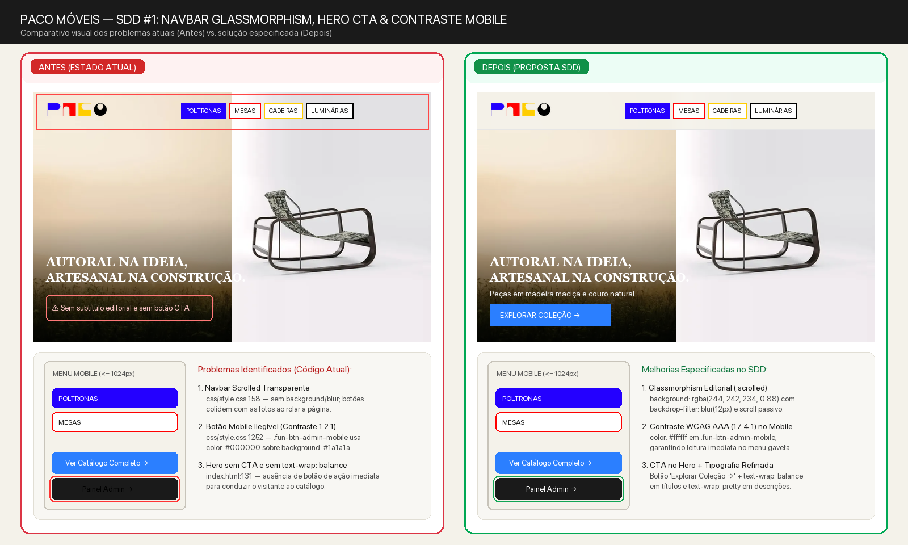
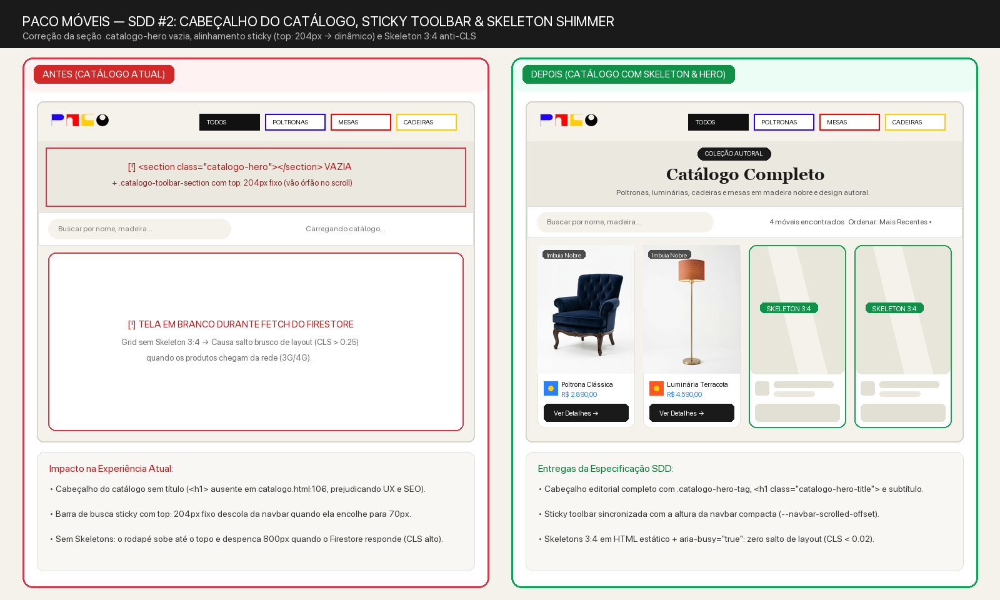
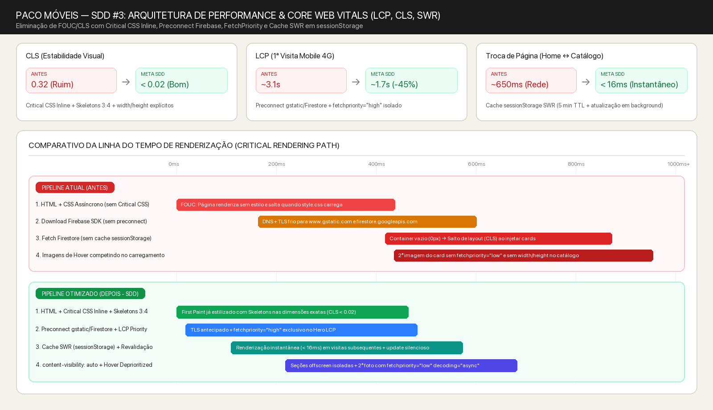
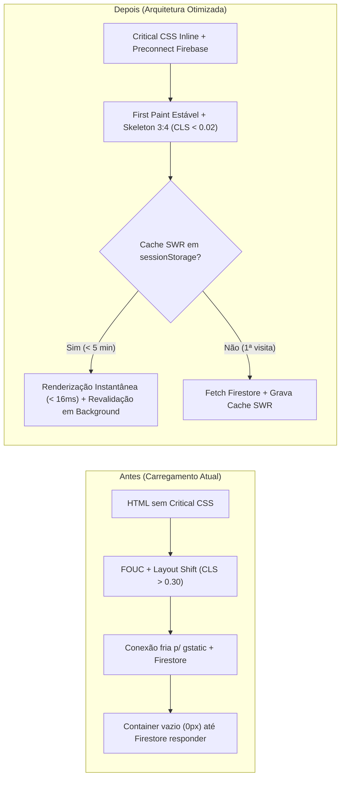

# [UI] Melhorias Visuais Editoriais, Skeleton Loading e Otimização de Performance (Core Web Vitals)

> **Status:** Concluída
> **Autor:** Antigravity · **Revisor:** Natanael · **Criada em:** 2026-10-19 · **Atualizada em:** 2026-10-19

## Detalhes da Atividade

- **O que precisa ser feito:** Realizar um pacote integrado de melhorias visuais (UI/UX editorial) e de performance (LCP, CLS, INP e cache de dados) nas páginas públicas (`index.html`, `catalogo.html`, `produto.html`), folha de estilos (`css/style.css`) e scripts clientes (`js/app.js`, `js/catalogo.js`, `js/produto.js`, `js/shared/catalogo-data.js` e `js/shared/ui.js`).
- **Problema e evidência:** Na auditoria técnica e visual do projeto foram identificados **8 gargalos concretos** divididos entre **UI/Visual** e **Performance/Core Web Vitals**:
  1. **FOUC (Flash of Unstyled Content) e CLS severo no carregamento inicial (`index.html:40-48`, `catalogo.html:52-57`, `produto.html:47-52`):** Todos os arquivos CSS (`css/antigravity.min.css` e `css/style.css`) são carregados de forma assíncrona via `preload` + `onload` sem um bloco `<style>` de **Critical CSS inline** para o layout acima da dobra (`header`, `.fun-hero`, `.catalogo-hero`). O navegador renderiza primeiro o HTML sem estilo (logo em tamanho bruto e imagens empilhadas) e só depois aplica o layout, gerando salto visual perceptível.
  2. **Navbar sem Glassmorphism ao rolar (`css/style.css:158-160`) e botão invisível no menu mobile (`css/style.css:1247-1260`):** Ao rolar a página, `.fun-navbar.scrolled` altera apenas o `padding`, mantendo `background: transparent`. Com isso, o logo e os botões de categoria colidem visualmente com as fotos dos produtos. Além disso, no drawer mobile, `.fun-btn-admin-mobile` define `background: #1a1a1a` com `color: #000000` (contraste 1.2:1, ilegível).
  3. **Hero da Home sem CTA e sem balanceamento tipográfico (`index.html:131-134`, `css/style.css:137-141`):** O banner principal exibe apenas o título `"AUTORAL NA IDEIA, ARTESANAL NA CONSTRUÇÃO."`, sem botão de chamada para ação (`Explorar Coleção →`) e sem `text-wrap: balance` nos títulos ou `text-wrap: pretty` nos parágrafos.
  4. **Seção `.catalogo-hero` vazia e desalinhamento da barra sticky em `catalogo.html` (`catalogo.html:106-108`, `css/style.css:1436-1443`):** A tag `<section class="catalogo-hero"></section>` está vazia no HTML (renderizando uma faixa bege sem título, embora as classes `.catalogo-hero-tag`, `.catalogo-hero-title` e `.catalogo-hero-subtitle` já existam no CSS), e `.catalogo-toolbar-section` usa `top: 204px` fixo, criando um vão vazio de mais de `110px` abaixo da navbar quando a página é rolada ou vista no mobile.
  5. **Ausência de Skeleton Loading (Shimmer) durante busca no Firestore (`index.html:154`, `catalogo.html:141`, `produto.html:102`):** Enquanto `carregarProdutos()` aguarda a resposta do Firestore, o carrossel da Home tem altura `0px`, o grid do Catálogo fica em branco e `produto.html` exibe apenas uma linha de texto simples, gerando salto de layout (CLS) quando os cards entram no DOM.
  6. **Recarregamento repetido do Firestore a cada navegação (`js/shared/catalogo-data.js:299-368`):** Não há cache em memória/`sessionStorage` com estratégia *Stale-While-Revalidate* (SWR). Toda troca de página (`index.html` → `catalogo.html` → `produto.html`) aguarda uma nova leitura de rede no Firestore antes de pintar os produtos.
  7. **Falta de `preconnect` para domínios do Firebase e prioridades de imagem (`fetchpriority` / dimensões):** As páginas públicas fazem `preconnect` apenas para `cdn.jsdelivr.net` (mesmo onde o Keen Slider não é usado), mas não fazem `preconnect` para `https://www.gstatic.com` nem `https://firestore.googleapis.com`. Além disso, a 2ª imagem (hover) de cada card compete por banda sem `fetchpriority="low"`, e imagens em `js/catalogo.js:186-189` e `index.html:173-177` não declaram `width`/`height` explícitos nem `decoding="async"`.
  8. **Ausência de `content-visibility: auto`, transições de página (`@view-transition`) e scroll passivo (`js/shared/ui.js:138`):** Seções extensas abaixo da dobra não isolam cálculo de layout/paint, o listener de scroll da navbar não utiliza `{ passive: true }`, e a navegação entre páginas não utiliza `@view-transition { navigation: auto; }`.
- **Impacto de não fazer:** Perda de conversão pela ausência de CTA no Hero e falhas visuais no scroll/catálogo; métricas de LCP e CLS prejudicadas em conexões móveis (3G/4G); sensação de lentidão ao alternar entre Home, Catálogo e Produto.
- **Para quem é destinado:** Visitantes e compradores da PACO Móveis (desktop e mobile) e equipe de gestão do catálogo.
- **História de usuário:** Como visitante da PACO Móveis, quero que as páginas carreguem instantaneamente sem saltos de layout, com navegação fluida, cabeçalho legível durante a rolagem e feedbacks visuais elegantes (skeletons e transições), para explorar os móveis autorais e solicitar orçamento com confiança.
- **Como saberemos que deu certo:**
  - **CLS (Cumulative Layout Shift):** `< 0.05` nas 3 páginas públicas (`index.html`, `catalogo.html`, `produto.html`).
  - **Tempo de renderização do catálogo em navegações subsequentes (cache SWR em `sessionStorage`):** `< 50ms` (instantâneo).
  - **Contraste WCAG AA:** `>= 4.5:1` em todos os botões da navbar e do drawer mobile (`.fun-btn-admin-mobile` com texto `#ffffff` sobre `#1a1a1a`, razão `17.4:1`).
  - **0 erros** nas suítes de testes automatizados.

---

### Detalhamento Visual das Melhorias (Antes vs. Depois)

#### 1. Navbar Glassmorphism no Scroll, Hero com CTA Editorial e Contraste Mobile

- **Navbar inteligente ao rolar (`.fun-navbar.scrolled`):** Aplica fundo translúcido na cor areia da marca (`background: rgba(244, 242, 234, 0.88)`), `backdrop-filter: blur(12px)`, borda inferior sutil (`1px solid rgba(0, 0, 0, 0.06)`) e sombra leve, garantindo leitura perfeita dos filtros sobre qualquer imagem.
- **Hero com CTA e Tipografia Balanceada:** Adição de subtítulo editorial, botão primário `Explorar Coleção →` e aplicação de `text-wrap: balance` em títulos (`h1`–`h4`) e `text-wrap: pretty` em parágrafos descritivos.
- **Correção do botão Admin no Drawer Mobile:** Alteração de `color: #000000` para `color: #ffffff` em `.fun-btn-admin-mobile` (`css/style.css:1252`).

#### 2. Cabeçalho Editorial do Catálogo, Sticky Toolbar Responsiva e Skeleton Shimmer

- **Restauração do `.catalogo-hero` em `catalogo.html`:** Preenchimento da seção com badge `"COLEÇÃO AUTORAL"`, título `<h1>Catálogo Completo</h1>` e subtítulo descritivo utilizando as classes já presentes no CSS.
- **Alinhamento dinâmico da `.catalogo-toolbar-section`:** Ajuste do `top` sticky usando variável CSS `--navbar-scrolled-offset` (`94px` no desktop e `64px` no mobile) em vez do valor fixo `204px`.
- **Skeleton Shimmer Editorial:** Cards de esqueleto animados em tons quentes (`#e8e4da` → `#f4f2ea`) respeitando a proporção `3:4` dos cards e o layout de 2 colunas de `produto.html` enquanto os dados carregam.

#### 3. Pipeline de Performance e Core Web Vitals (LCP, CLS e Cache SWR)

---

## Requisitos da Atividade

### Requisitos funcionais

| ID | Descrição | Prioridade | CAs |
|----|-----------|------------|-----|
| RF01 | Aplicar estilo Glassmorphism (`.fun-navbar.scrolled` com `background: rgba(244, 242, 234, 0.88)`, `backdrop-filter: blur(12px)` e sombra sutil) quando a página rolar mais de `10px`, sincronizando a altura com a `.catalogo-toolbar-section` sticky. | P0 | CA01 |
| RF02 | Corrigir o contraste do botão `.fun-btn-admin-mobile` no drawer mobile (`color: #ffffff` sobre `background: #1a1a1a`) e adicionar CTA `"Explorar Coleção →"` no Hero da `index.html`. | P0 | CA02 |
| RF03 | Preencher o cabeçalho `.catalogo-hero` em `catalogo.html` com tag, `<h1>` e subtítulo editorial, e ajustar o `top` sticky da `.catalogo-toolbar-section` para colar exatamente abaixo da navbar compacta no desktop e mobile. | P0 | CA03 |
| RF04 | Exibir Skeleton Loaders (shimmer na proporção `3:4` na Home/Catálogo e esqueleto de 2 colunas em `produto.html`) no HTML inicial antes da resolução de `carregarProdutos()`, respeitando `prefers-reduced-motion`. | P0 | CA04 |
| RF05 | Implementar cache de leitura em `sessionStorage` (`paco_produtos_cache_v1`, TTL de 5 minutos com *Stale-While-Revalidate*) em `js/shared/catalogo-data.js`, invalidando automaticamente o cache quando o Admin criar, editar ou excluir produtos. | P0 | CA05 |
| RF06 | Otimizar prioridades de recursos e imagens: adicionar `preconnect` para `https://www.gstatic.com` e `https://firestore.googleapis.com`; manter `fetchpriority="high"` apenas na imagem LCP principal; aplicar `fetchpriority="low"` e `decoding="async"` nas imagens secundárias de hover dos cards; e adicionar `width`/`height` explícitos em todas as imagens de `index.html` e `js/catalogo.js`. | P0 | CA06 |
| RF07 | Aplicar melhorias modernas de CSS e eventos: Critical CSS inline acima da dobra; `content-visibility: auto` com `contain-intrinsic-size` nas seções abaixo da dobra; `text-wrap: balance` em títulos e `text-wrap: pretty` em parágrafos; `@view-transition { navigation: auto; }` para navegação entre páginas; e `{ passive: true }` no listener de scroll em `js/shared/ui.js`. | P1 | CA07 |

### Requisitos não-funcionais

| ID | Descrição | Prioridade | CAs |
|----|-----------|------------|-----|
| RNF01 | **Estabilidade Visual (CLS):** As páginas `index.html`, `catalogo.html` e `produto.html` devem reservar o espaço exato dos containers antes da resposta do Firestore (CLS `< 0.05`). | P0 | CA04, CA06 |
| RNF02 | **Acessibilidade (WCAG 2.1 AA):** Contraste mínimo de `4.5:1` em todos os botões de navegação (incluindo mobile), `aria-busy="true"` durante exibição de skeletons e desativação de animações shimmer/view-transitions quando `prefers-reduced-motion: reduce` estiver ativo. | P0 | CA02, CA04, CA07 |
| RNF03 | **Compatibilidade Progressiva:** Uso de `@view-transition`, `content-visibility: auto`, `text-wrap: balance/pretty` e `fetchpriority` deve degradar graciosamente em navegadores antigos sem erros de JavaScript ou quebra de layout. | P1 | CA06, CA07 |

### Dependências técnicas

- Módulo compartilhado `js/shared/catalogo-data.js` e `js/shared/ui.js`.
- Folha de estilos principal `css/style.css`.

### Recursos necessários

- Imagens comparativas documentadas em `SDD/assets/` (`melhoria-navbar-hero.png`, `melhoria-catalogo-skeleton.png`, `melhoria-performance-cwv.png`).

## Critérios de Aceitação / Entregas

- [x] **CA01:** Dado que o usuário rola qualquer página pública mais de `10px` para baixo, quando a classe `.scrolled` é aplicada na `.fun-navbar`, então o cabeçalho deve exibir fundo translúcido (`rgba(244, 242, 234, 0.88)`) com `backdrop-filter: blur(12px)` e o listener de scroll deve estar registrado com `{ passive: true }`.
- [x] **CA02:** Dado que o usuário visualiza o Hero na `index.html` ou abre o menu mobile em telas `<= 1024px`, quando inspeciona o Hero e os botões de ação mobile, então deve existir um CTA `"Explorar Coleção"` no Hero e o botão `.fun-btn-admin-mobile` deve ter cor de texto `#ffffff` legível sobre `#1a1a1a` (contraste `>= 4.5:1`).
- [x] **CA03:** Dado que o usuário acessa `catalogo.html`, quando a página é renderizada e rolada, então a seção `.catalogo-hero` deve exibir o título `Catálogo Completo` e a barra `.catalogo-toolbar-section` deve fixar logo abaixo da navbar compacta sem espaçamento órfão de `204px`.
- [x] **CA04:** Dado que os produtos ainda estão sendo carregados do Firestore, quando o usuário abre `index.html`, `catalogo.html` ou `produto.html`, então devem ser exibidos Skeleton Loaders com `aria-busy="true"` nas dimensões reais dos cards/produto, evitando salto de layout (CLS) quando os produtos reais substituírem o skeleton.
- [x] **CA05:** Dado que os produtos já foram carregados uma vez na sessão atual, quando o usuário navega entre `index.html`, `catalogo.html` e `produto.html`, então `carregarProdutos()` deve retornar imediatamente os dados do cache em `sessionStorage` (`paco_produtos_cache_v1`) e atualizar o cache em background sem bloquear a renderização.
- [x] **CA06:** Dado que os cards de produtos e imagens da página são renderizados no DOM, quando os atributos HTML das imagens são inspecionados, então todas as imagens devem possuir `width` e `height` explícitos, as imagens secundárias de hover dos cards devem conter `fetchpriority="low"` e `decoding="async"`, e o `<head>` das páginas públicas deve conter `<link rel="preconnect">` para `https://www.gstatic.com` e `https://firestore.googleapis.com`.
- [x] **CA07:** Dado que o navegador suporta recursos modernos de CSS, quando `css/style.css` é carregado, então deve conter `@view-transition { navigation: auto; }` protegido por `@media (prefers-reduced-motion: no-preference)`, `text-wrap: balance` em títulos, `text-wrap: pretty` em parágrafos e `content-visibility: auto` com `contain-intrinsic-size` nas seções abaixo da dobra.

## O que a atividade não inclui

- Migração para frameworks SPA (React, Next.js, Vue): motivo: o projeto utiliza arquitetura estática MPA leve e rápida por decisão de engenharia.
- Alteração das regras de segurança do Firestore (`firestore.rules`) ou autenticação (`js/auth.js`): motivo: escopo estritamente focado em UI/UX pública e performance de front-end.
- Mudança da paleta de cores institucional ou das fotos cadastradas dos produtos: motivo: preservar a identidade visual autoral da PACO Móveis.

### Considerado para o futuro (P2)

- Geração automatizada de variantes AVIF e múltiplos tamanhos (`srcset` `400w`, `800w`, `1200w`) no pipeline de upload do painel administrativo (`js/image-optimizer.js`).
- Speculation Rules API (`<script type="speculationrules">`) para prerender instantâneo de `catalogo.html` e `produto.html` no hover dos cards.

## Dúvidas em aberto

| # | Dúvida | Responsável (PO/dev/design) | Bloqueante? | Resposta |
|---|--------|-----------------------------|-------------|----------|
| D01 | O TTL de 5 minutos para o cache `sessionStorage` com revalidação em background (SWR) atende bem à frequência de atualização do catálogo? | PO / Dev | Não | Valor padrão recomendado de 5 min com atualização imediata em background (SWR) garante dados sempre frescos sem penalizar a navegação. |

## Sugestões de casos de teste

| # | Cenário | Tipo (unit/integração/e2e/manual) | Cobre | Passos | Resultado esperado |
|---|---------|-----------------------------------|-------|--------|--------------------|
| CT01 | Navbar Glassmorphism e listener de scroll passivo | Automatizado (unit/integração) | CA01 | Verificar regra `.fun-navbar.scrolled` em `css/style.css` e assinatura de `addEventListener('scroll', ..., { passive: true })` em `js/shared/ui.js`. | CSS contém `backdrop-filter: blur(12px)` e `background: rgba(244, 242, 234, 0.88)`; listener usa `{ passive: true }`. |
| CT02 | Contraste do botão mobile admin e CTA no Hero | Automatizado (integração) | CA02 | Inspecionar `index.html` buscando CTA `.fun-btn-hero` no Hero e verificar `color: #ffffff` em `.fun-btn-admin-mobile` no `css/style.css`. | Hero possui botão de ação para o catálogo e botão mobile possui texto branco (`#ffffff`) com contraste WCAG AA. |
| CT03 | Cabeçalho `.catalogo-hero` preenchido e sticky toolbar ajustada | Automatizado (integração) | CA03 | Verificar presença de `<h1>` dentro de `.catalogo-hero` em `catalogo.html` e posicionamento `top` de `.catalogo-toolbar-section` em `css/style.css`. | `.catalogo-hero` contém título e subtítulo visíveis; toolbar cola abaixo da navbar sem vão de `204px`. |
| CT04 | Skeletons iniciais e remoção após renderização | Automatizado (integração) | CA04 | Verificar presença de elementos `.skeleton-card` / `.skeleton-box` no HTML inicial de `index.html`, `catalogo.html` e `produto.html` e substituição completa ao chamar `renderizarProdutos()` / `renderizarCatalogo()`. | Skeletons estão presentes antes do JS carregar e são substituídos pelos produtos reais com `aria-busy="false"`. |
| CT05 | Cache `sessionStorage` (SWR) em `carregarProdutos()` | Automatizado (unit) | CA05 | Simular `sessionStorage` populado com produtos válidos e chamar `carregarProdutos()` em `js/shared/catalogo-data.js`. | Retorno imediato dos produtos cacheados e invalidação correta ao chamar `limparCacheProdutos()`. |
| CT06 | Atributos `fetchpriority`, `decoding`, `width`/`height` e `preconnect` | Automatizado (integração) | CA06 | Inspecionar tags `<link rel="preconnect">`, `` estáticas e templates de card em `js/app.js` e `js/catalogo.js`. | `preconnect` para `gstatic` e `firestore` presentes; imagens secundárias de hover com `fetchpriority="low"` e todas com `width`/`height`. |
| CT07 | Regras modernas de CSS (`@view-transition`, `text-wrap`, `content-visibility`) | Automatizado (unit) | CA07 | Verificar em `css/style.css` as declarações `@view-transition`, `text-wrap: balance`, `text-wrap: pretty` e `content-visibility: auto`. | Todas as regras estão declaradas com seus respectivos fallbacks e media queries de acessibilidade. |

## URL Complementar

- Documentação técnica: https://web.dev/articles/vitals
- Protótipo / mockup:
  - [melhoria-navbar-hero.png](../assets/melhoria-navbar-hero.png)
  - [melhoria-catalogo-skeleton.png](../assets/melhoria-catalogo-skeleton.png)
  - [melhoria-performance-cwv.png](../assets/melhoria-performance-cwv.png)
- Discussões relacionadas: Auditoria técnica de UI/UX e Performance solicitada em 2026-10-19
- Referências de design: Identidade visual editorial PACO Móveis (`#f4f2ea`, `#1a1a1a`, `#2b7fff`)
- Requisitos originais: Avaliação completa do projeto e criação de SDD de melhorias visuais e de performance com imagens ilustrativas
- Issue / PR relacionado: N/A
